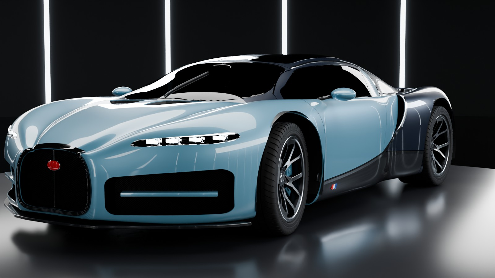
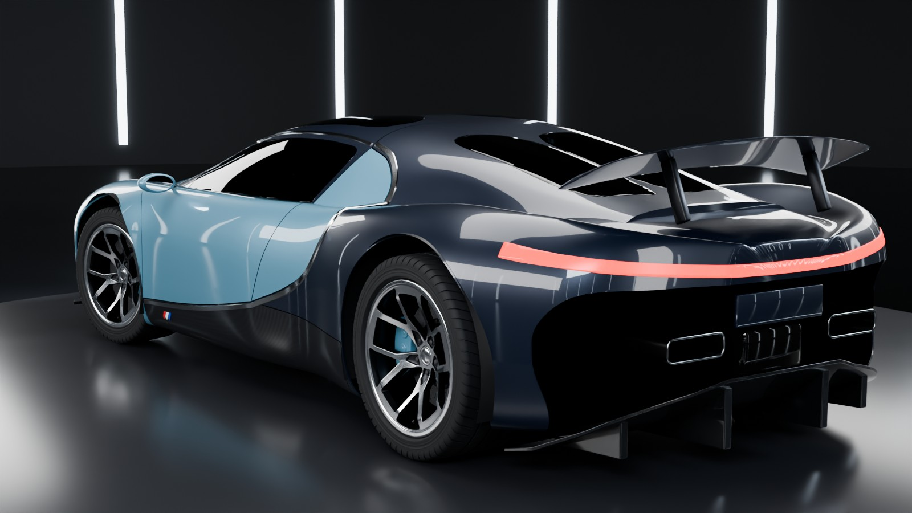
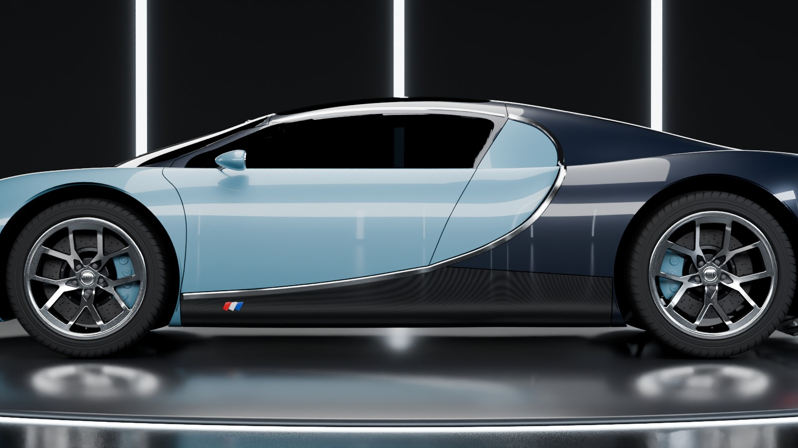
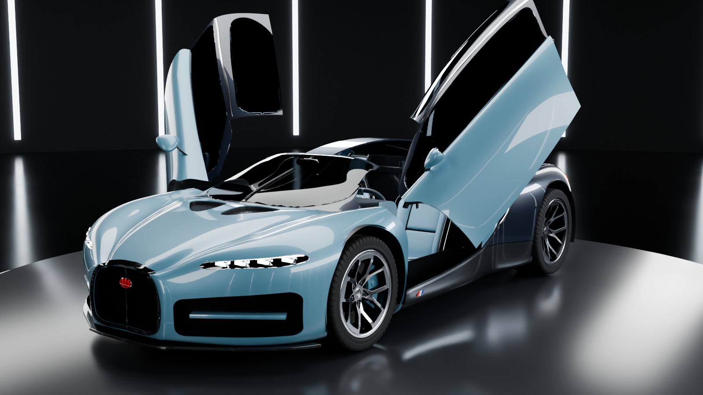
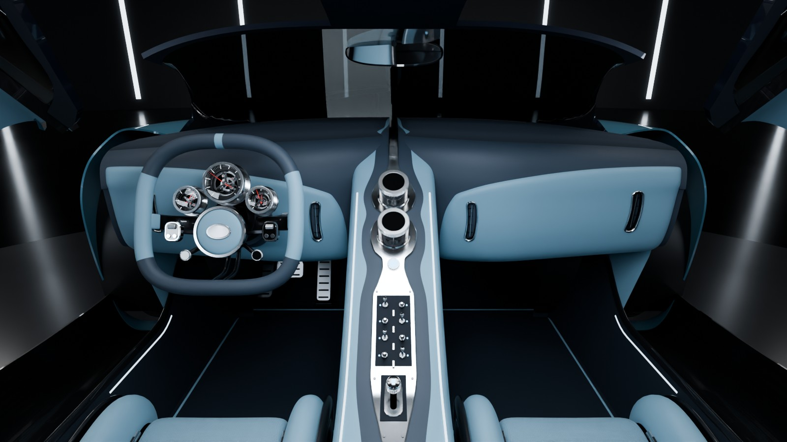
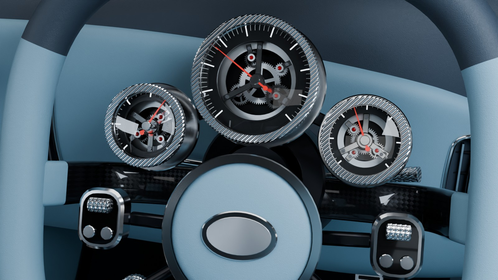

# Bugatti Tourbillon — procedural Blender model and showcase film

A modular model of the Bugatti Tourbillon built entirely from Python scripts in Blender 5.2,
measured against the dimensioned blueprint, with working doors, lights, wing, steering and
wheels, a showroom, and a 40-second film with an original synthesised soundtrack.

- **Film:** [`video/tourbillon_showcase.mp4`](video/tourbillon_showcase.mp4)
- **Blender file:** [`blender/tourbillon.blend`](blender/tourbillon.blend) (Blender 5.2 or newer) — the rigged
  car on the showroom stage with a hero camera; press F12 to render. Select `TB_CTRL` to work the
  doors, lights, wing and steering (see *Working functions* below).

<!-- stills -->
| | |
| --- | --- |
|  |  |
|  |  |
|  |  |
<!-- /stills -->

Nothing here is a downloaded asset: every mesh, material, light, camera move and sound is
generated by the code in this folder.

## The film

| Time | Shot |
| --- | --- |
| 0–2 s | The dark stage fades up on the turntable |
| 2–12 s | The car assembles: chassis, engine, wheels, seats, dashboard, clamshells, doors, roof and wing fly in and lock into place, each on a beat |
| 12 s | Lights on: headlights, light bar and the full showroom rig come up together |
| 12–24 s | Front three-quarter push-in, side tracking shot, rear three-quarter crane with the wing deploying |
| 24–28 s | Macros of the wheel and brake, then the horseshoe grille |
| 28–36 s | The front wheels straighten, the dihedral doors rise, and the camera moves into the cabin as its lights come on |
| 36–40 s | Doors close, wide hero shot, fade to black |

The soundtrack is original and synthesised in code (`tb/audio.py`): a watch-escapement tick
motif, a mechanical accent on every assembly hit, and a D-minor theme (Dm–B♭–F–C) at 120 BPM
that enters when the lights come on. Every accent is placed from the same timeline as the
animation, so they land on the frame.

## Build it

Needs Python 3.13 with `bpy` 5.2 (`pip install bpy shapely scipy pillow opencv-python-headless`).

```bash
python3 build.py --showroom --save blender/tourbillon.blend   # rigged car on the stage (~60 s)
python3 render.py build                    # car + showroom + animation -> renders/film.blend
python3 render.py frames --res 1280x720 --samples 18   # resumable; skips frames that exist
python3 render.py encode                   # frames + soundtrack -> video/tourbillon_showcase.mp4
python3 tb/audio.py soundtrack.wav         # the soundtrack on its own (8 s to render)
```

## How it is put together

| Module | What it builds |
| --- | --- |
| `tb/spec.py` | Every dimension and hard point, measured from the blueprint |
| `tb/surface.py` | The two analytic master surfaces: lower hull and teardrop canopy |
| `tb/body.py` | Trims the surfaces against each other, cuts wheel arches, then cuts real panels with 4 mm gaps: front and rear clamshells, doors, quarters, sills, glass, grille and lamp openings |
| `tb/details.py` | LED lamps, mirrors, wiper, C-line trim, splitter, diffuser, exhausts, active wing, engine, arch liners |
| `tb/wheels.py` | Rims, tyres with cut tread, carbon-ceramic discs, calipers |
| `tb/interior.py` | Tub, seats, dashboard, console, fixed-hub steering wheel, skeleton three-dial cluster |
| `tb/rig.py` | One control object that drives every moving or switchable part |
| `tb/environment.py` | Showroom, turntable, softbox rig and lighting moods |
| `tb/animation.py`, `tb/timeline.py` | Assembly sequence, camera shots, light cues |
| `tb/audio.py` | The soundtrack, synthesised with numpy and locked to the timeline |
| `tb/materials.py` | 47 shared procedural materials |

Surfaces are Catmull-Clark subdivided lofts of guide curves, so reflections stay continuous
across panels; panels are cut from them with outlines drawn in the side, front, rear and plan
views, so shut lines sit where the blueprint puts them.

## Working functions

Select `TB_CTRL` and change its custom properties (all are keyframable):

| Property | Range | Effect |
| --- | --- | --- |
| `door_L`, `door_R` | 0–1 | Dihedral doors, 70° about a hinge solved to clear fender, roof and ground |
| `headlights` | 0–1 | LED modules, running-light strips and two real spot lamps |
| `taillights` | 0–1 | Full-width rear light bar |
| `interior_lights` | 0–1 | Ambient strips, instrument back-lighting, cabin lamp |
| `wing` | 0–1 | Active rear wing rises and tilts |
| `steer` | −1–1 | Front wheels and steering rim (the hub and instruments stay still) |
| `wheel_spin` | radians | All four wheels roll |

Drivers use simple expressions, so they work without enabling Python auto-run.

## How it was checked

- **Blueprint:** `tools/extract_blueprint.py` reads the silhouettes off the blueprint and
  `tb/compare.py` renders the model in the same four orthographic frames. Silhouette overlap
  of the finished car: side 95.5%, plan 96.2%, front 94.2%, rear 94.1%. Scale read from
  overall length and from wheelbase agree to 0.1%.
- **Rig:** `tools/test_rig.py` builds the car and checks every control numerically: both doors
  open up and out symmetrically and close back exactly, each light group switches its emitters
  and lamps, the wing rises and tilts, steering turns only the front wheels and the steering rim,
  and all four wheels roll the same way (11 checks, all passing).
- **Doors:** `tools/solve_hinge.py` searches hinge positions and axes and keeps one where no
  sampled point of the door enters the fixed body at any opening angle; open bounds of the
  left and right doors are mirror images.
- **Independent critics:** separate agents compared renders with the reference photos and
  returned ranked fix lists for the exterior and the interior, and both were applied.
  Exterior: paint and glass depth, deep-red light bar, open rear with ramped carbon diffuser,
  rounder C-line with a wider aluminium strip, trapezoid intakes, aero mirror pods, dark side
  glass, calmer lighting. Interior: carbon-shell bucket seats, closed footwells and dash ends,
  dark dash roll over pale wings, waisted console blade with 70 mm crystal dials, finer
  three-dial cluster, upright steering wheel.
- **Soundtrack:** 40.000 s, −15.5 LUFS integrated, true peak −1.4 dBFS.

## What is approximate

This is a faithful study, not CAD data.

- The body is two smooth lofted surfaces. Overall proportions match the blueprint; the sharp
  hood creases, the long carbon channels beside the hood spine and the depth of the rear
  haunches are softer than on the real car.
- The interior follows the reference layout and the critic's fixes are applied, but the
  footwells are dark and the smallest switchgear and the headrest slots are simplified.
- Wheels follow the five twin-spoke layout but not the exact blade shape.
- No brand logos, lettering or scripts are reproduced: the grille badge and hub pad are
  plain ovals and the tail plate is blank.
- The film is rendered at 1280×720 with 18 samples per pixel and denoising on a CPU-only
  machine.
