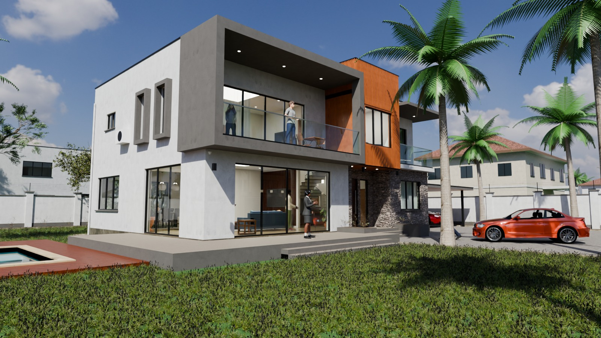

# Duplex house

A modern two-storey duplex in a walled compound, built entirely from Python in Blender (Cycles).
The house sits in a built-up street of other compounds, not in an empty field.



## What is in the scene

- **The house** (`house.py`): 15 × 11 m plan, two floors, plan-driven walls with real openings,
  aluminium windows and sliders, pivot front door, U-shaped stair with glass balustrades,
  framed master balcony, timber-batten centre volume, stone-clad base, parapet roof.
- **Interiors** (`interior.py`): living room, dining room, kitchen with island, entrance hall,
  guest bedroom and bath, master suite with bath and walk-in closet, three more bedrooms,
  upstairs lounge. Sofas, beds, wardrobes, kitchen units, appliances, sanitaryware, rugs,
  curtains, art, pendant and recessed lights.
- **The compound** (`compound.py`): perimeter wall with stone gate pillars and electric-fence
  wire, sliding gate, gatehouse, paved drive, carport, pool with deck and loungers, lawn with
  instanced grass, planting beds, palms, boys' quarters, generator house, water tower,
  AC units, solar panels, roof tank.
- **The neighbourhood**: street with kerbs, covered drains, street lights, power lines, about
  thirty neighbouring plots (restyled copies of this duplex plus hipped-roof houses), parked
  cars, trees.
- **Cars**: BMW 1M, Ferrari 458, a concept coupé, and photo-textured street cars.
- **People**: a mixed cast generated from MakeHuman data (see `../blender-kit/mh.py`).

## Run it

```bash
pip install bpy==5.3.0 DracoPy numpy pillow
../fetch_assets.sh                       # cars and people data (about 2 GB)
python3 build.py --cams hero,aerial,living --res 1920x1080 --samples 96
python3 build.py --anim exterior --frames 72 --res 960x540 --samples 16
python3 build.py --save duplex.blend     # write a .blend to open in Blender
```

Cameras: `hero front drive gate street aerial aerial2 pool back living dining kitchen hall master bath bed2`.
Flags: `--no-veg` (skip the heavy trees and grass for fast previews), `--no-interior`, `--no-people`,
`--sun <azimuth>`, `--gate <0..1>`.

## Unreal Engine

The scene is built and rendered in Blender. To use it in Unreal, save the `.blend`
(`--save duplex.blend`), open it in Blender on a desktop machine, and export FBX or glTF.
All architecture has metre-scale UVs and image-based PBR materials, so it transfers cleanly.
Grass and trees are instanced scans and are better replaced with Unreal foliage.

## Credits

Textures, skies, furniture, trees and plants: Poly Haven (CC0). BMW 1M: Mike Pan, Blender
Foundation benchmark file (CC0). Ferrari 458 Italia: vicent091036, from the three.js examples
(CC BY). CarConcept: Khronos glTF Sample Assets (CC BY 4.0). Street cars: OSRF Gazebo models.
People: MakeHuman base mesh and system assets (CC0) and community asset packs (CC0 and CC BY).
