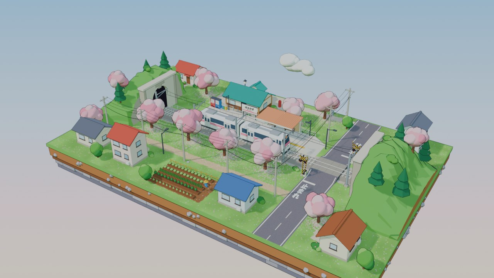
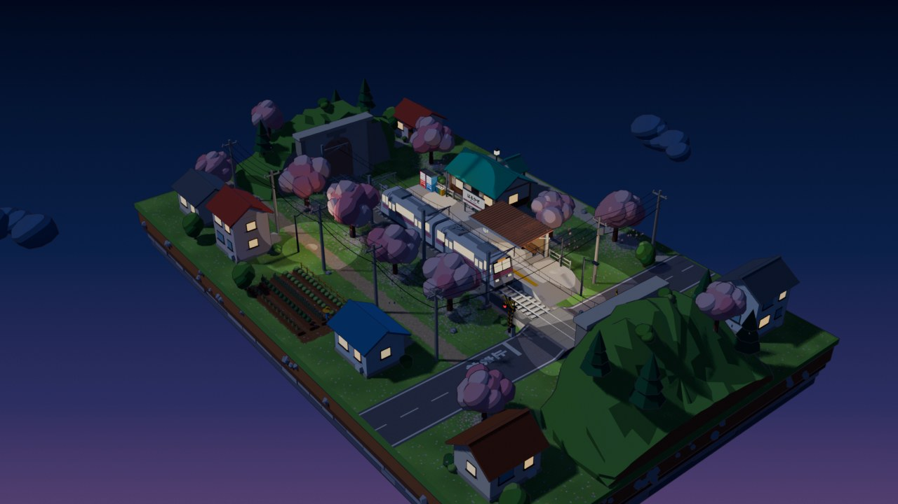

# Harukaze Station · 春風駅

A low-poly 3D diorama of a rural Japanese railway station in spring, built with
[three.js](https://threejs.org). One HTML file, no build step, no imported models or images:
every mesh is built from primitives in code, and the grass, road, signs, clock face and
vending machines are painted on canvases at load.

**▶ [Open it](https://badboyvee.github.io/BlackHoleeee/harukaze-station/)**, or open
`index.html` in a browser. Three.js and the Noto Sans JP webfont load from CDNs.

## What's in it

- **A floating block**: a grass top on layers of turf, earth with bedded pebbles, a dark
  band and two courses of rough-cut stone, hung in a pastel sky.
- **The line**: a single track on ballast and concrete sleepers, overhead catenary on steel
  masts, and green hills at both ends with concrete tunnel portals set into stone retaining
  walls.
- **The station**: a concrete platform with a yellow tactile strip, a shelter with a
  corrugated roof, benches, a two-faced clock showing your local time, the name board
  (はるかぜ / Harukaze, between Sakuradai and Yamabiko), vending machines, recycling bins,
  lamps and a fence. Steps lead down to a small station building with a teal gable roof and
  a 春風駅 sign on both faces, a lantern and a post box on its gravel forecourt.
- **The level crossing**: striped poles, crossbucks, twin red lamps on both faces, barrier
  arms, a raised crossing deck, stop lines and 止まれ painted on the road.
- **The village**: six houses, a vegetable patch with a scarecrow, utility poles with
  sagging wires, cedars and round trees, azalea bushes, and eleven cherry trees with puffy
  blossom crowns and fallen petals painted on the grass beneath them.

## What happens

- Every 32 seconds a two-car commuter train (white, pink stripe, pantograph on the wire)
  leaves the west tunnel, stops at the platform and opens its doors on the platform side.
  It then departs into the east tunnel. Clipping planes at the tunnel darkness hide it
  inside the hills.
- Before it leaves, the crossing lamps blink alternately and the arms come down. They rise
  once the tail has cleared the road.
- 460 instanced sakura petals drift on a gusting wind, settle on the grass or the platform
  for a moment, then blow off the trees again.
- The camera orbits slowly; drag to look around, scroll or pinch to zoom.
- Night mode darkens the sky and brings out the stars. Windows light up, the lamps glow
  with point lights and additive sprites, and the crossing lamps and train headlights glow.

## Controls

| input                  | action                                   |
| ---------------------- | ---------------------------------------- |
| drag / pinch / scroll  | orbit and zoom                           |
| Day / Night (`N`)      | switch the time of day                   |
| Orbit (`O`)            | turn the slow auto-orbit on or off       |
| Train (`T`)            | call the next train now, or right after the current one |

The status line under the title says where the train is and when the next one is due.

## How it's built

- **Toon look**: every surface is a `MeshToonMaterial` sharing one three-step gradient map,
  with dark ink outlines from `OutlineEffect`. Outline thickness is set per material, so
  rails, wires and fences stay fine while buildings get a bolder line. Soft PCF shadows
  come from one directional light.
- **Few draw calls**: parts are collected per material while the scene is built,
  transformed into world space and merged. About 1,600 primitives go in; the scenery bakes
  down to 59 meshes, and the two-car train to 15 plus the eight door leaves that slide.
- **Same scene every time**: all placement, jitter and painting comes from one seeded
  random generator (mulberry32), drawn in a fixed order.
- **The timetable** is a pure function of a 32 s cycle time. That drives the train
  position, doors, crossing lamps, barrier arms and the status line, which is how the Train
  button can jump or queue the next run.
- **Glows**: lamp, crossing and headlight glows are additive sprites. They are hidden
  during the outline pass so they are not drawn twice.
- **Phones**: the camera fits the block to the screen's aspect and lifts it above the
  interface. Phones render at a capped pixel ratio, and the resolution drops once if the
  frame rate stays low.
- **Reduced motion**: with `prefers-reduced-motion`, the auto-orbit starts off, petals
  drift at a third of the speed, clouds stay still and day/night switches instantly.

Add `?debug` to the URL to expose `window.__station` (jump the timetable, read draw calls).

## Blender version




[`blender/harukaze_station.py`](blender/harukaze_station.py) builds the same diorama in
Blender, from code alone like the web version. It needs Blender 4.2 LTS or newer and was
tested on 4.2 and 5.2.

```sh
blender --python harukaze_station.py                    # build it, then look around
blender -b --python harukaze_station.py -- --save harukaze_station.blend
blender -b --python harukaze_station.py -- --render day.png
blender -b --python harukaze_station.py -- --render night.png --night --frame 340
blender -b --python harukaze_station.py -- --render-anim frames/
```

Options: `--frame N` (1–768; the default, 300, has the train at the platform), `--night`,
`--resolution 1920x1080` and `--samples 32`. Building takes about ten seconds and the saved
`.blend` (about 14 MB) packs its images and font, so it opens anywhere.

- **The same scene**: the layout, timetable and seeded random generator are ported from
  `index.html`, so the block, station, crossing, village and trees match the web version.
- **Toon look in EEVEE**: one node group turns the light on a white diffuse surface into
  flat bands with Shader to RGB and a constant colour ramp, but keeps its colour, so
  moonlight stays blue and lamplight warm. Ink outlines are inverted hulls (a Solidify
  modifier with flipped normals and a back-face-culled ink material), the same trick
  `OutlineEffect` uses. Every merged mesh sets its own line width.
- **Painted textures**: the grass, with its fallen petals, and the road and vending-machine
  fronts are painted into images with numpy and packed into the file. The signs, the name
  board and 止まれ are text objects in Blender's bundled Noto Sans CJK, scaled to a
  measured glyph height.
- **The tunnels**: every train material goes transparent outside the two tunnel mouths,
  which does the job of the web version's clipping planes.
- **One seamless 32 s loop** (768 frames at 24 fps): the train, doors, barrier arms and
  alternating crossing lamps are keyed frame by frame from the timetable. Each of about 460
  geometry-nodes petals falls from a blossom crown on a period that divides 32 s. The
  camera makes one full turn per loop.
- **Day to night**: drag the `night` custom property (Scene properties > Custom
  Properties) from 0 to 1. Drivers fade the sky, sun, ambient light, lamps, lit windows,
  glows, stars and the train's headlight.

## The prompt

```
Build a single self-contained HTML file: an interactive low-poly 3D diorama of a rural
Japanese railway station in spring, using Three.js (ES modules from a CDN). No external
models or images — generate all geometry from primitives in code and paint textures
(grass, signs) on <canvas>.

Style: a floating diorama block (grass top, layered earth and stone sides) on a soft pastel
sky gradient. MeshToonMaterial with a 3-step gradient map, dark ink outlines
(OutlineEffect), soft directional shadows, bright saturated palette.

Scene:
- A single railway track across the block, running into green tunnel hills with concrete
  portals at both ends.
- Concrete platform with a yellow tactile strip, a shelter with a corrugated roof, benches,
  a hanging clock, a small station building with a teal gable roof and a "春風駅" sign, a
  station name board (はるかぜ / Harukaze, with neighbouring stations), vending machines,
  bins, lamps, fence.
- A road crossing the track with a level crossing: striped poles, crossbuck, red flashing
  lamps, barrier arms; road markings and "止まれ".
- Utility poles with sagging wires, overhead catenary, small village houses, a vegetable
  patch, bushes, and cherry trees with puffy pink blob crowns and fallen petals painted on
  the grass.

Animation:
- A two-car commuter train (white with a pink stripe, pantograph) comes out of one tunnel,
  stops at the platform, then departs into the other; clipping planes hide it inside the
  tunnels. Loop every ~32 s.
- Crossing lamps blink alternately and the arms lower before the train passes, then rise.
- ~460 instanced sakura petals drifting in the wind.
- Slow auto-orbit camera; OrbitControls for drag and zoom.

UI (English): bottom-left title "春風駅 / Harukaze Station" with a small caption;
bottom-right glass toolbar with Day / Night, Orbit on/off, and Train (call the next
train). Night mode: dark sky with stars, lit windows, lamp point lights with additive glow
sprites, glowing crossing lamps and train headlights.

Technical: merge static meshes by material into a few dozen draw calls; use a seeded
random so the scene is identical on every load; responsive down to phone width; respect
prefers-reduced-motion.
```
