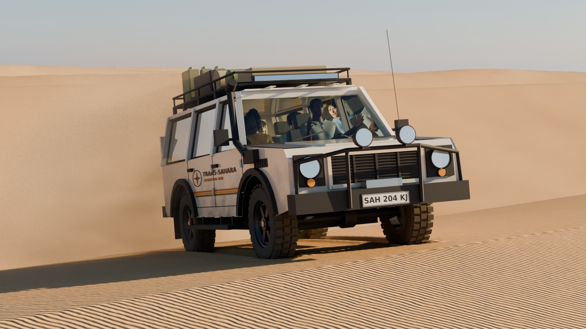

# Sahara voyage

Three men and two women crossing a Saharan dune field in a loaded 4x4, built from Python in
Blender (Cycles). A separate project from the duplex house.



## What is in the scene

- **Dunes**: a 3.6 km erg from one height function (long windward ramps, short slip faces, a
  second smaller dune set), meshed at three densities so the sand under the truck is fine
  enough to carry real tyre ruts.
- **Sand**: procedural colour drift, wind ripples and grain, with aerial haze toward the horizon.
- **Sky**: Blender's physical sky with a low sun and dusty air.
- **The truck** (`../blender-kit/suv.py`): long-wheelbase 4x4 station wagon with a real cabin,
  roof rack, jerry cans, spare wheels, sand ladders, snorkel, bull bar, livery and plates.
  It is my own model, not a licensed real vehicle.
- **The crew**: five seated figures visible through the glass; in the `stop` set-up they are
  out of the truck on the dune.
- **Dust**: a volumetric plume trailing the rear wheels.

## Run it

```bash
pip install bpy==5.3.0 DracoPy numpy pillow
../fetch_assets.sh
python3 build.py --cams drive,wide,side,front,aerial,rear --res 1920x1080 --samples 96
python3 build.py --mode stop --cams stop,stopwide --res 1920x1080 --samples 96
python3 build.py --anim --frames 72 --fps 12 --res 960x540 --samples 16
python3 build.py --save sahara.blend
```

Useful flags: `--sun-el`, `--sun-rot`, `--haze`, `--dust`, `--heading`, `--exposure`.

## Credits

Rocks and scrub: Poly Haven (CC0). People: MakeHuman base mesh and system assets (CC0) and
community asset packs (CC0 and CC BY).
