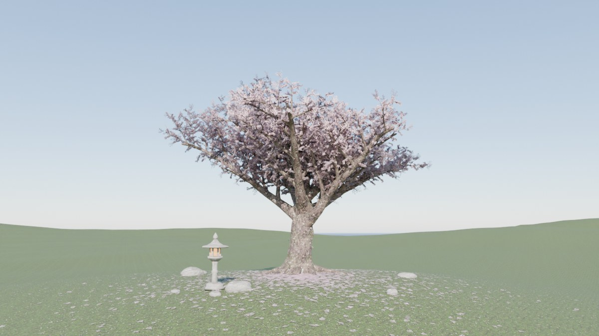

# 桜 Sakura

A cherry tree in full bloom, through a whole day. One three.js page, no build step.

**▶ [Open it](https://badboyvee.github.io/BlackHoleeee/sakura/)**

Drag to orbit, scroll to zoom right in on the blossoms. The dock at the bottom is the day: the switch runs it
or stops it, the slider scrubs the hour, the chips jump to dawn, sunrise, morning, noon, golden hour, sunset,
dusk and night.

## What is in it

**The tree** is grown branch by branch when the page loads (`buildSkeleton` in `index.html`): a leaning trunk
that flares into buttresses and surface roots, a whorl of scaffold limbs that rise and then arch over, and
four more orders of branching down to the twigs that flower. About twelve thousand branches. The big wood is
pushed in and out by the bark's own height map, so the bole has a broken outline; moss sits low on the trunk
and on top of the limbs; a few blossoms sprout straight from the bark, as they do on old cherries.

**The blossoms** are not painted. `tools/blender/build_assets.py` models them in Blender as real geometry
(five notched, cupped, veined petals around a calyx, a ring of stamens with anthers, a pistil; buds; pedicels
gathered in umbels that spiral up a twig; a few young bronze leaves) and renders them with Cycles into one
atlas: colour, coverage, normal, occlusion and translucency. On the tree every twig is dressed in those
"sleeves" of blossom, two or three cards crossed around its own axis, so the flowers sit where a cherry
carries them, along last year's wood. Each sleeve is lit like the cylinder it stands for; petals pass light
(they glow with the sun behind them) and scatter it to each other.

**Bark, turf, soil and stone** come from the same script. The bark is a height field (plates split by
furrows, rows of lenticels, lichen) raised as geometry in Blender and rendered for its normals and occlusion.
The turf is fifteen thousand modelled blades and clover over soil, rendered from above; on the page it is
drawn at three scales so it never visibly repeats, under a quarter of a million blades that follow the camera
and take their colour from the turf beneath them.

**The day.** The sun rises in the east at six, stands 58° high at noon and sets at six; a full moon rises as
it goes down. By day the sky is the Preetham model (the one three.js's `Sky` object uses); around sunrise and
sunset a keyed twilight takes over, with its glow and the pink arch opposite the sun; at night there are
stars, the moon and a trace of the Milky Way. Whatever the sky looks like, it is also the light: it is
rendered into a small cube a few times a second and used as the scene's environment, and the haze takes the
colour of the horizon (warmer towards the sun). One shadow-casting light is the sun by day and the moon by
night. The stone lantern lights at dusk.

**The lens.** Depth of field from a thin lens (f/1.8 on a 35 mm frame) that focuses on whatever is in the
middle of the picture: a whole tree is sharp front to back, a blossom at arm's length floats in front of a
soft crown. Light shafts where the low sun finds gaps in the branches, a little bloom, film grain.

**Also:** petals that fall, drift downwind and settle; a carpet of them under the crown; wind through
everything, from one function; a soft orbit when you leave it alone.

## Blender

Blender is used twice.

1. **To make the textures** (already done; the result is `assets/textures.js`). To rebuild them:

   ```
   pip install bpy pillow numpy        # or use the Blender app
   python tools/blender/build_assets.py                 # everything, about four minutes on four cores
   python tools/blender/build_assets.py bark            # only one group: blossoms, bark, grass, soil, stone
   blender -b --python tools/blender/build_assets.py    # the same, inside Blender
   ```

   Previews of each texture land in `tools/blender/out/`.

2. **To open the tree itself in Blender.** The menu (☰) has *Export tree for Blender*: it saves
   `sakura-tree.glb`, with the wood, every spray of blossom, the fallen petals, the knoll, the lantern and the
   stones as plain meshes with ordinary materials. Import it with *File › Import › glTF 2.0*, or let the
   script set up the sun, sky and camera and render it with Cycles:

   ```
   python tools/blender/render_tree.py sakura-tree.glb render.png --hour 8.2
   blender --python tools/blender/render_tree.py -- sakura-tree.glb
   ```

   

## Controls

| | |
|---|---|
| Drag, scroll, right-drag | orbit, zoom, pan |
| Space | run or stop the day |
| ← → | scrub a quarter of an hour |
| 1 – 8 | dawn, sunrise, morning, noon, golden hour, sunset, dusk, night |
| H, F | hide the interface, fullscreen |

The menu also sets the wind, the falling petals, the slow orbit, depth of field and the quality. Quality is
automatic by default: it lowers the resolution first, then the detail, until the frame rate holds.

Address options: `?t=17.5` starts at that hour, `?pause` starts with the day stopped, `?q=high|medium|low`
fixes the quality, `?seed=7` grows a different tree.

## Files

```
index.html                      the page: tree, sky, lens, interface
assets/textures.js              the Blender-made textures, as data URIs (so the page also opens from file://)
tools/blender/build_assets.py   models and renders the textures
tools/blender/render_tree.py    opens the exported tree in Blender and renders it
card.jpg, blender.jpg           the page's opening view, and the exported tree rendered in Blender
```

three.js 0.186 is loaded from jsDelivr. WebGL 2 is required.
