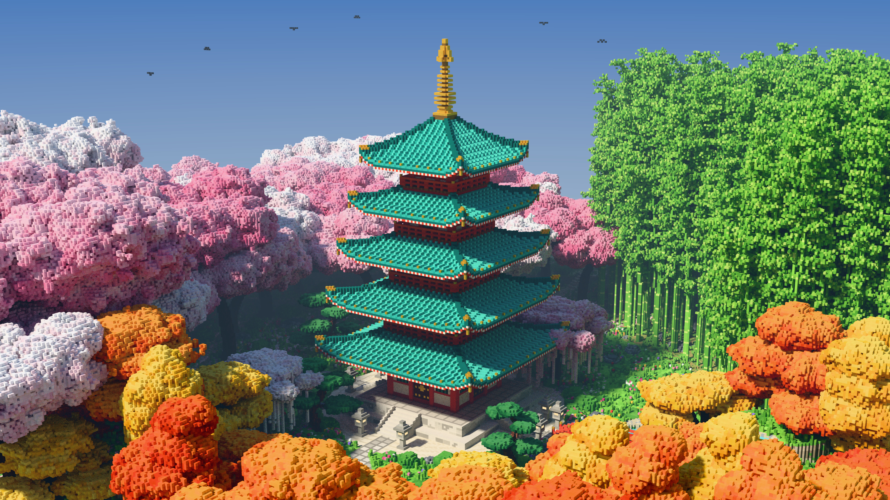

# Voxel Pagoda

A five-story Japanese pagoda in a spring garden, built entirely from cubic voxels and
path-traced to a 4K still.



Nothing is modelled by hand or loaded from disk. `scene.js` places every voxel
procedurally into a 512 × 256 × 480 grid (about 14 million solid cubes): the pagoda with
its vermilion pillars, bracketed eaves, swept teal tile roofs and gold finial; cherry
trees, a bamboo grove, maples and ginkgos on stepped stone mounds, a pond with a bridge,
koi and lily pads, stone lanterns, and a few birds.

## Rendering it

```sh
node tools/export.js scene.bin                      # build the grid (~4 s)
gcc -O3 -march=native -ffast-math -pthread -o pt tools/pathtracer.c -lm
./pt scene=scene.bin out=frame.f32 w=3840 h=2160 spp=40
python3 tools/tonemap.py frame.f32 3840 2160 render-4k.jpg
```

`tools/pathtracer.c` is a small CPU path tracer: a disc sun with soft shadows, a sky
dome, diffuse bounce light, light passing through leaves and blossoms, reflective water
and a little haze. More `spp` gives a cleaner image; it costs about 3.5 s per sample at
4K on four cores. `tonemap.py` needs `numpy` and `Pillow`.

The camera and sun are set at the bottom of `scene.js`; `eye=`, `target=`, `fov=` and
`sun=` on the `pt` command line override them.
