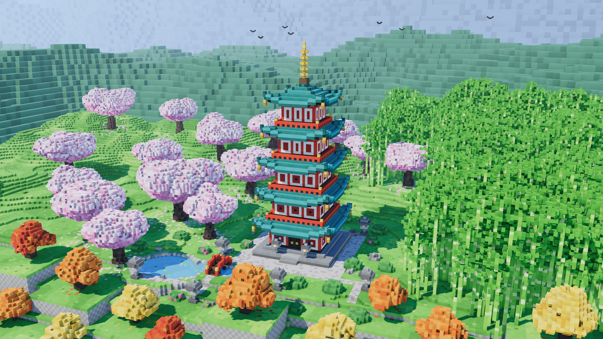

# Voxel Pagoda — a cherry-blossom garden in cubes

A five-story Japanese pagoda in a garden at full bloom, built entirely from unit
cubes and rendered with [three.js](https://threejs.org). One HTML file, no build
step, no meshes or textures: the whole world is generated at load from a seed.

Open `index.html` in a browser, or serve the folder:

```sh
python3 -m http.server 8000
```

Drag to orbit, scroll to zoom, right-drag to pan. **Reset view** returns to the
composed shot; **Save 4K still** renders a 3840×2160 PNG of the current view.
`index.html?still` renders that frame once, headless-friendly, with no UI.



## How it is made

The garden is a `368 × 112 × 240` voxel grid (one byte per cell, a material id).
Builders write into it in order: terrain, pond and paths, the bridge, the pagoda,
then trees, bamboo, shrubs, rocks and lanterns. A mesher walks the grid and emits
a quad for every cube face that touches air, so the 2.4 million filled cells
become about 1.5 million triangles rather than 14 million.

| piece | how |
| ----- | --- |
| terrain | value-noise height field, flattened to a plateau for the pagoda, stepped into 2-voxel terraces at the front with dressed-stone cliff faces, plus raised platforms for the autumn trees |
| pagoda | five bodies of shrinking half-width (10 → 6) with vermilion pillars, cream plaster, shoji windows and doors; each roof is a stepped hip pyramid whose eave rows lift at the corners (`t^2.4` curve) for the upturned edge, with ridge caps, light eave tiles, rafters beneath, gold bells, walkway railings and a nine-ring gold sōrin on top |
| cherry trees | tapered trunk, 5–7 branches each ending in a blossom ellipsoid; the outer shell mixes white and three pinks with small holes, petals fall on the lawn below |
| bamboo | 1-voxel stalks 16–40 tall with pale node rings every 4–6 cubes and leaf clusters on the upper half; height and density follow a noise field so the grove has clearings and a ragged edge |
| autumn trees | three stacked ellipsoids plus side clusters in orange, red or gold palettes, brighter on top, deeper underneath |
| backdrop | two coarser grids: 4-unit wooded hills that wrap the left and back of the garden and 8-unit mountains on the horizon, both softened by exponential fog |

### Lighting

Light comes from a warm directional sun with a 4096² PCF shadow map, a cool fill
from behind, and a gradient sky dome that is also baked into a PMREM environment
map so sky-blue bounce reaches every shaded face. Ambient occlusion is baked per
vertex at mesh time: the classic three-neighbour corner term, multiplied by a
seven-ray hemisphere cast through the voxel grid from each face, which darkens
ground under canopies and the slots beneath the eaves. A patched
`MeshStandardMaterial` applies it to the indirect light fully and to the sun
slightly. ACES tone mapping, no bloom.

## The prompt

Built with [Claude Code](https://claude.com/claude-code) from a single
image-style brief: a premium 3D voxel-art scene of a five-story pagoda with
vermilion pillars and teal tiled roofs in a cherry-blossom garden, bamboo on the
right, orange and golden trees cascading over a raised blocky foreground, a clear
blue sky with tiny birds, three-quarter elevated view, 4K 16:9.
